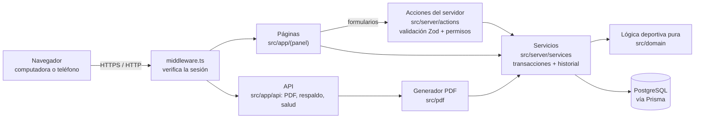

# Starfutbol · Panel administrativo

Aplicación web para administrar los torneos dominicales de futbol 7 de Starfutbol: ligas, equipos,
jugadores, calendario automático, resultados, tabla general, goleo, sanciones, eliminatorias, PDF para
WhatsApp (uno por liga) e historial de cambios. Funciona en computadora y teléfono.

---

## Arquitectura

Es una sola aplicación **Next.js** (frontend y backend juntos) conectada a una base de datos **PostgreSQL**.
No hay servicios externos: todo corre en el mismo equipo.



| Capa | Carpeta | Qué hace |
|---|---|---|
| Pantallas | `src/app/(panel)/` | Páginas del panel (componentes de servidor de React). Leen datos y muestran formularios. |
| Componentes | `src/components/` | Botones, tablas, formularios, menú lateral. |
| Acciones | `src/server/actions/` | Reciben los formularios: validan con Zod, revisan permisos y llaman a los servicios. |
| Servicios | `src/server/services/` | Operaciones que tocan la base de datos, siempre en transacciones y con registro en el historial. |
| Dominio | `src/domain/` | Reglas deportivas sin base de datos (probadas con pruebas unitarias): puntuación y penales, tabla y desempates, calendario round-robin con algoritmo húngaro para horarios y canchas, conflictos, eliminatorias, goleo, completar jornada. |
| PDF | `src/pdf/` | Plantillas con `@react-pdf/renderer`, fuentes y fondos propios; se sirven en `/api/pdf/<documento>`. |
| Datos | `prisma/` | Esquema de la base, migraciones, configuración inicial (`seed.ts`) y datos de demostración (`demo.ts`). |
| Seguridad | `src/middleware.ts`, `src/server/auth.ts` | Sesión firmada (JWT en cookie httpOnly), contraseñas con bcrypt, rutas protegidas. |

**Principios:**
- Las estadísticas (tabla, goleo) **no se guardan**: se recalculan siempre desde los resultados oficiales, así nunca se duplican.
- Cada cambio importante queda en el **historial** (quién, cuándo, antes/después y motivo).
- La base de datos impide errores graves por sí misma (por ejemplo, dos partidos en la misma cancha y horario).

**Datos principales:** Torneo → Sede → Canchas · Temporada → Ligas → Equipos → Jugadores · Temporada → Horarios,
Jornadas → Partidos → Resultado + Goleadores · Sanciones · Cuadro de eliminatorias · Usuarios · Historial.

**Tecnologías:** Next.js 15 · React 19 · TypeScript · Tailwind CSS 4 · Prisma 6 · PostgreSQL 16 (Docker) ·
Zod · jose + bcryptjs · @react-pdf/renderer · Vitest · playwright-core.

---

## Instalación desde cero (otra computadora)

### 1. Requisitos

| Programa | Para qué | Dónde |
|---|---|---|
| **Node.js 20 o superior** (probado con 23.9) | Ejecutar la aplicación | https://nodejs.org |
| **Docker Desktop** | Base de datos PostgreSQL | https://www.docker.com/products/docker-desktop |
| **Git** | Descargar el código | https://git-scm.com |
| Chrome o Edge | Solo para las pruebas con navegador | — |

> Si ya tienes un PostgreSQL 14+ propio, puedes usarlo en lugar de Docker (ver [docs/INSTALACION.md](docs/INSTALACION.md)).

### 2. Descargar e instalar

```bash
git clone https://github.com/Stranxhy/Starfut.git
cd Starfut
npm install
```

> Recomendado: no guardar el proyecto dentro de OneDrive u otra carpeta sincronizada (ver *Problemas comunes*).

### 3. Crear el archivo `.env`

Copia el ejemplo:

```bash
cp .env.example .env          # macOS / Linux / Git Bash
copy .env.example .env        # Windows (cmd)
```

Abre `.env` y completa **dos valores obligatorios**:

- `AUTH_SECRET`: una clave aleatoria larga. Genérala con:
  ```bash
  node -e "console.log(require('crypto').randomBytes(48).toString('base64url'))"
  ```
- `ADMIN_PASSWORD`: la contraseña del primer administrador (mínimo 10 caracteres, letras y números).
  Si lo dejas vacío, el paso 4 genera una y la muestra en pantalla.

El archivo `.env` contiene secretos: **nunca lo subas a GitHub** (ya está excluido en `.gitignore`).

### 4. Preparar la base de datos

Con **Docker Desktop abierto**:

```bash
npm run db:up        # enciende PostgreSQL en Docker (puerto 5433)
npm run db:migrate   # crea las tablas
npm run db:seed      # configuración inicial + usuario administrador
```

`db:seed` crea: torneo *Starfutbol*, sede *Suc. Ticomán*, 5 canchas, una temporada con las ligas *Premium* y
*Liga 2*, 14 jornadas, 6 horarios (08:10 a 12:20), reglas de puntuación (3-0, penales 2-1) y el cuadro de
eliminatorias. Todo se puede cambiar después en **Ajustes → Configuración**.

Opcional, para practicar con datos ficticios: `npm run db:demo` (crea una temporada "[DEMO]" separada;
se elimina con `npm run db:demo -- --clean`).

### 5. Encender la aplicación

```bash
npm run build        # solo la primera vez y después de cada actualización
npm start            # http://localhost:3000
```

Entra con `ADMIN_EMAIL` (por defecto `admin@starfutbol.local`) y `ADMIN_PASSWORD` de tu `.env`.

**En Windows** basta con doble clic en **`iniciar-starfutbol.bat`**: abre Docker si hace falta, enciende la
base de datos y la aplicación (compilándola la primera vez) y abre el navegador. Deja abierta la ventana
negra "Starfutbol" mientras uses la aplicación.

Para usarla desde el teléfono en la misma red Wi-Fi: `http://<IP-de-la-computadora>:3000`.
Para publicarla en Internet, ver [docs/DESPLIEGUE.md](docs/DESPLIEGUE.md).

---

## Actualizar a una versión nueva

```bash
npm run db:backup    # respaldo antes de actualizar
git pull
npm install
npm run db:migrate   # aplica cambios en la base, si los hay
npm run build
npm start
```

---

## Comandos

| Comando | Descripción |
|---|---|
| `npm start` / `npm run build` | Servidor de producción / compilación |
| `npm run dev` | Servidor de desarrollo (más lento, para programar) |
| `npm run db:up` | Enciende PostgreSQL en Docker |
| `npm run db:migrate` | Aplica migraciones pendientes (no borra datos) |
| `npm run db:seed` | Configuración inicial y administrador (se puede repetir sin duplicar) |
| `npm run db:demo` / `npm run db:demo -- --clean` | Crea / elimina la temporada de demostración |
| `npm run db:backup` | Respaldo completo en `backups/` |
| `npm run db:restore -- <archivo> --base <nueva>` | Restaura un respaldo en una base nueva |
| `npm test` | Pruebas unitarias e integración (usa `TEST_DATABASE_URL`) |
| `npm run test:e2e -- <url>` | Prueba completa con navegador (ver [docs/PRUEBAS.md](docs/PRUEBAS.md)) |
| `npm run nav-check` | Verifica que la navegación responda (clics reales) |
| `npm run smoke -- <url>` | Revisa que todas las pantallas carguen |
| `npm run typecheck` | Verificación de tipos |
| `npm run pdf:samples` | Genera muestras de todos los PDF con la temporada demo |

---

## Problemas comunes

| Síntoma | Solución |
|---|---|
| `Can't reach database server at localhost:5433` | Abre Docker Desktop y ejecuta `npm run db:up`. |
| El puerto 5433 está ocupado | Define otro en `.env` (`POSTGRES_PORT=5434`) y ajusta el puerto en `DATABASE_URL`. |
| `AUTH_SECRET no está configurado` | Completa `AUTH_SECRET` en `.env` (mínimo 32 caracteres) y reinicia. |
| `EINVAL: readlink … .next` al compilar | Pasa dentro de OneDrive; `npm run build` ya lo corrige limpiando `.next`. Si persiste, mueve el proyecto fuera de OneDrive. |
| `Could not find a production build` | Ejecuta `npm run build` antes de `npm start`. |
| La página no abre después de reiniciar la computadora | La aplicación no arranca sola: usa `iniciar-starfutbol.bat` o `npm start`. |
| Olvidé la contraseña | Otro administrador la restablece en **Ajustes → Usuarios y respaldos**. |

---

## Documentación

- [docs/MANUAL.md](docs/MANUAL.md) — manual de uso para el administrador
- [docs/INSTALACION.md](docs/INSTALACION.md) — instalación detallada y variables de entorno
- [docs/RESPALDOS.md](docs/RESPALDOS.md) — copias de seguridad y restauración
- [docs/DESPLIEGUE.md](docs/DESPLIEGUE.md) — publicar en un servidor o en Internet
- [docs/PRUEBAS.md](docs/PRUEBAS.md) — pruebas y resultados obtenidos
- [docs/REGLAS_Y_DECISIONES.md](docs/REGLAS_Y_DECISIONES.md) — reglas deportivas confirmadas y pendientes
- [docs/ESTADO.md](docs/ESTADO.md) — funcionalidades y limitaciones conocidas

## Estructura de carpetas

```
prisma/              esquema, migraciones, seed (configuración inicial) y demo (datos ficticios)
src/app/(panel)/     pantallas del panel
src/app/api/         PDF, escudos, respaldo JSON y verificación de salud
src/app/login/       inicio de sesión
src/components/      componentes de interfaz, formularios y menú
src/domain/          lógica deportiva pura
src/server/actions/  acciones del servidor (formularios)
src/server/services/ servicios con transacciones
src/pdf/             plantillas, fuentes e imágenes de los PDF
public/brand/        logotipos
tests/               pruebas unitarias e integración
scripts/             respaldo, restauración, pruebas con navegador, muestras PDF
docs/                documentación
iniciar-starfutbol.bat  arranque con doble clic (Windows)
```
